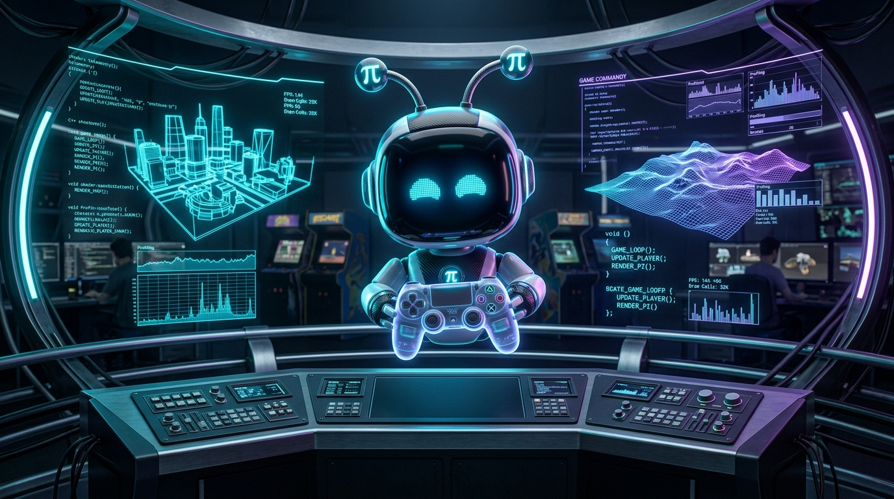
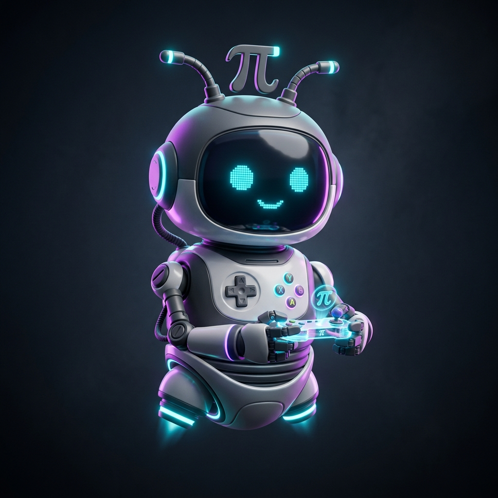

# Pi Game Studio

<p align="center">
  
</p>

<p align="center">
  
</p>

<p align="center">
  Turn a Pi session into a full game development studio.
  <br />
  Compact AI Studio — 8 Core roles + 1 Engine Specialist + 1 read-only verifier (8+1+1). 6 ODD skills. ODD workflow.
</p>

<p align="center">
  <a href="LICENSE"></a>
  <a href="agents"></a>
  <a href="skills"></a>
  <a href="chains"></a>
  <a href="starters"></a>
  <a href="extensions"></a>
  
</p>

```text
               ⠐⢿⡿⠂                   P I   G A M E   S T U D I O   v1.10.0
           ⢀⣤⣶⣶⣶⣾⣷⣶⣶⣶⣤⡀               Compact AI Game Studio for Pi (8+1+1 Architecture)
           ⣿⡇⢸⡏⢩⡍⢩⡍⢹⡇⢸⣿               ──────────────────────────────────────────────────────────
           ⣿⡇⢸⣇⣐⣒⣒⣂⣸⡇⢸⣿               GIT:       On branch main
           ⠈⠛⠛⣛⣿⣿⣿⣿⣛⠛⠛⠁               PATH:      ~/Games/pi-game-studio
            ⣴⡟⠩⣿⠍⢉⣭⡉⢻⣦                ENGINE:    Godot · Unity · Unreal · Bevy · Raylib · Phaser
            ⠙⢷⣤⣴⣶⣶⣯⣤⡾⠋                AGENTS:   10 activos (8 Core + 1 Motor + 1 Verificador)
              ⣿⠉⣭⣭⠉⣿                  STAGE:     Entorno OK
             ⣿⣶    ⣶⣿                 SKILLS:    6 ODD pipeline (/concept, /spec, /arch, /code, /test, /ship)
           ⢾⣿⣿⡷  ⠸⣿⣿⣷⠆                STORAGE:   Local storage (Persistent Memory)
           ⠐⠶⠶⠶⠶  ⠶⠶⠶⠶⠂               TIPS:      /concept · /spec · /code · /studio · /studio:setup
```

---

## Why This Exists

Building a game solo with AI is powerful — but a single chat session has no structure. No one stops you from hardcoding magic numbers, skipping design docs, or writing spaghetti code. There's no QA pass, no design review, no one asking "does this actually fit the game's vision?"

**Pi Game Studio** solves this by giving your AI session the structure of a real studio with the high-speed, lean execution of **Gentle Shell**. Instead of a slow monolithic assistant or an overwhelming roster of 50+ background processes, you get a compact, focused team of **8 Core roles + 1 Engine Specialist + 1 read-only verifier (8+1+1)**: directors who guard the vision, department leads who own their domains, and dedicated engine specialists who do the hands-on work.

The result: you still make every decision, but now you have a fast, coordinated team that asks the right questions, catches mistakes early, and keeps your project organized from first brainstorm to launch without wasting tokens or stalling in background loops.

---

## Table of Contents

- [What's Included](#whats-included)
- [Key Mappings (CCGS → Pi)](#key-mappings-ccgs--pi)
- [Studio Hierarchy (8+1+1)](#studio-hierarchy-811)
- [Architecture & Flowcharts](#architecture--flowcharts)
- [Model Mapping](#model-mapping)
- [Customizing Models](#customizing-models)
- [Slash Commands](#slash-commands)
- [Getting Started](#getting-started)
- [Project Structure](#project-structure)
- [How It Works](#how-it-works)
- [Design Philosophy](#design-philosophy)
- [Source & Credits](#source--credits)
- [License](#license)

---

## What's Included

| Category      | Count | Description                                                                                                              |
| ------------- | ----- | ------------------------------------------------------------------------------------------------------------------------ |
| **Agents**    | 8+1+1 | Compact active studio: 8 Core roles + 1 dedicated Engine Specialist per project + 1 always-installed read-only verifier    |
| **Subagents** | Native| Isolated child process execution via `subagent_run`, `subagent_list`, `subagent_status`, `subagent_result` & `subagent_steer`   |
| **Interactive**| Native| Interactive terminal menus & batch questionnaires via `ask_user_question` (arrow keys & Enter)             |
| **Skills**    | 6 ODD | Full lifecycle pipeline: `/concept`, `/spec`, `/arch`, `/code`, `/test`, `/ship`                                          |
| **Chains**    | 3     | Multi-agent execution pipelines via native isolated subagents (`subagent_run`)                                           |
| **Starters**  | 6     | Starter Kits for 6 major engines (Bevy, Godot, Phaser, Raylib, Unity, Unreal)                                                    |
| **Hooks**     | 8     | Automated validation on commits, pushes, skill changes, and session audit/gap detection                                  |
| **Engram**    | 1     | Optional persistent memory — decisions auto-save across sessions when Engram is connected, and specialists persist durable discoveries; without it the runner strips `mem_save` and records the gap instead of asking a child for a tool it lacks |
| **Deny baseline** | — | Least-privilege `deny:` frontmatter per role (patterns or `"*"` default deny), forwarded as `--exclude-tools` so deny wins over allow, plus one `**Boundary:**` line per template stating what the role must never do |
| **Setup**     | 2     | `/setup` — install agents and model config; `/assign-models` — customize models per agent                                |

## Key Mappings (CCGS → Pi)

| CCGS (Claude Code)            | Pi Game Studio                                        |
| ----------------------------- | ----------------------------------------------------- |
| `.claude/agents/*.md`         | `agents/*.md` (source) → `.pi/agents/` (via `/setup`) |
| `.claude/skills/*/SKILL.md`   | `skills/*/SKILL.md`                                   |
| `.claude/docs/templates/*.md` | _Retired — ODD live specs in `design/gdd/` replace master templates_ |
| `.claude/hooks/*.sh`          | `extensions/hooks/index.ts`                           |
| `.claude/rules/*.md`          | _Handled in-line by skills_                           |
| `CLAUDE.md`                   | `package.json` (pi manifest)                          |
| `.claude/settings.json`       | `models.default.json`                                 |

## Studio Hierarchy (8+1+1)

Agents are organized into a lean hierarchy designed for maximum speed and token efficiency:

```text
Tier 1 — Directors (Strategy & Governance)
  producer (Lead Orchestrator)
  creative-director (Game Vision & Pillars)
  technical-director (Architecture & Budgets)

Tier 2 — Department Leads & Core Devs
  game-designer (Mechanics & Systems)
  gameplay-programmer (Mechanics & Physics Implementation)
  art-director (Visual Direction & Art Bible)
  audio-director (Soundscapes & Music)
  qa-lead (Testing & Quality Gates)

Tier 3 — Engine Specialist (+1 per project)
  bevy-specialist | godot-specialist | phaser-specialist | raylib-specialist | unity-specialist | unreal-specialist
```

### Engine Specialists (+1 por Proyecto)

| Engine              | Dedicated Specialist | Focus & Core Tools |
| ------------------- | -------------------- | ------------------ |
| **Bevy (Rust)**     | `bevy-specialist`    | Idiomatic ECS, wgpu, WASM, cargo |
| **Godot 4**         | `godot-specialist`   | Node trees, GDScript/C#, shaders, GDExtension |
| **Phaser (TypeScript / WebGL)** | `phaser-specialist` | Arcade/Matter physics, Vite HMR, Canvas/WebGL, TypeScript |
| **Raylib (C++)**    | `raylib-specialist`  | EnTT ECS, GLSL shaders, ImGui, CMake |
| **Unity**           | `unity-specialist`   | MonoBehaviour/DOTS, Shader Graph, UI Toolkit |
| **Unreal Engine 5** | `unreal-specialist`  | C++, GAS, Blueprints, Replication, UMG |

> 📖 **Manuales y Herramientas del Estudio**:
> - [`AGENTS.md`](AGENTS.md): Directorio completo y responsabilidades del equipo oficial **8+1+1**.
> - [`docs/architecture-flowcharts.md`](docs/architecture-flowcharts.md): **Diagramas de Flujo y Arquitectura Completa** — Visualización paso a paso del pipeline ODD de 6 fases, la jerarquía 8+1+1, subagentes en vivo, compilación Web/WASM, profiler y sintetizador procedural.
> - [`docs/gamedev-interaction-protocol.md`](docs/gamedev-interaction-protocol.md): **Protocolo de Respuestas y Decisiones (Gentle Shell for Games)** — Bloque 0: *Executive Delivery & Zero Bleed*, Pillars Header, Trade-offs Matrix, Choice Envelopes, Radar, Return Contracts, **Gobernanza Comercial & Modelado Boxleiter** y **Flow Completion Protocol**.
> - [`docs/skills-reference.md`](docs/skills-reference.md): Catálogo de las **6 skills ODD** y comandos `studio:*` organizados por fases.
> - **Única Fuente de Verdad (Single Source of Truth)**: `design/gdd/` y `design/art/` exclusivos para diseño y arte; `production/` exclusivo para roadmaps y sprints.
> - **Diagnóstico y Salud de Entorno**: Detección automática al iniciar o decir *"hola"` (`Estado: ✔ Entorno OK`), con setup Automático o Manual sin preguntas redundantes.
> - **Brújula de Producción del Producer**: Lectura y actualización automática de `production/roadmap.md` (`<!-- PRODUCER_STATE -->`) para saber en qué línea va el proyecto en todo momento.
> - **Diagnóstico Multiplataforma y Salud ODD (`/studio:doctor`)**: Auditoría automática de compiladores, toolchains y SDKs locales para los 6 motores, integridad del árbol ODD y recuento de placeholders en `assets/manifest.yaml`.
> - **Calidad Automatizada y Generadores Locales**: Runner de pruebas de estabilidad y fugas de memoria (`npm run test:soak`) y generador procedural de SFX (WAV) y texturas (BMP) sin dependencias (`npm run assets:placeholders`).

## Architecture & Flowcharts

Para una comprensión visual exhaustiva de cómo interactúan los agentes, motores, herramientas de telemetría y pipelines, consulta:
👉 **[Guía Completa de Diagramas de Flujo (Mermaid)](docs/architecture-flowcharts.md)**

Incluye diagramas detallados de:
1. **Pipeline ODD Gamedev (6 Fases Oficiales)**
2. **Jerarquía y Roles del Estudio (8+1+1)**
3. **Subagentes Aislados & Visor en Vivo (`/studio:subagents`)**
4. **WebAssembly / Web One-Click Build & Runner (`/studio:web`)**
5. **Live Performance Profiler & Budget Tracker HUD (`/studio:profile`)**
6. **Sintetizador Procedural de Audio y Paletas de Shaders (`/studio:sfx` & `/studio:palettes`)**
7. **Pipeline de CI/CD Automatizado con GitHub Actions**

---

## Model Mapping

Pi Game Studio uses **model inheritance**: all agents ship with `model: inherit`, meaning they use the default model of your Pi session. This avoids hardcoding model choices into agent definitions.

The recommended model assignment lives in `models.default.json`:

| Tier                      | Default model                         | Thinking Effort | Rationale                                                                     |
| ------------------------- | ------------------------------------- | --------------- | ----------------------------------------------------------------------------- |
| **Directors** (Tier 1)    | `openai-codex/gpt-5.4-mini`           | `high`          | Heaviest model for strategic planning, architecture, and cross-team decisions |
| **Workhorses** (Tier 2–3) | `openrouter/openai/gpt-oss-120b:free` | `medium`        | Balanced model for day-to-day design, implementation, and review              |
| **Lightweight** (Special) | `openrouter/openai/gpt-oss-20b:free`  | `low`           | Fast model for simple, repetitive tasks, logs, and community updates          |

After running `/setup`, the mapping is written to `.pi/game-studio/models.json`. You can edit it directly or use `/assign-models` to change models interactively.

Agents ship with `model: inherit`, so without overrides every agent uses the model of your active Pi session. `models.default.json` contributes only the three tier defaults (`director`, `workhorse`, `lightweight`).

## Customizing Models

### Via `/assign-models` (interactive)

```bash
/assign-models
```

The skill guides you through:

- Assign a model to an entire tier (director, workhorse, lightweight)
- Assign a model to a specific agent
- Preview changes before applying (dry-run)
- Reset to package defaults

### Via `models.json` (manual)

Edit `.pi/game-studio/models.json`:

```json
{
  "director": "openai-codex/gpt-5.4-mini",
  "workhorse": "openrouter/openai/gpt-oss-120b:free",
  "lightweight": "openrouter/openai/gpt-oss-20b:free",
  "creative-director": "anthropic/claude-sonnet-4"
}
```

Tier keys apply to every agent of that tier; a real agent name adds a single override on top of its tier default.

Agents not listed use the session default.

### Provider examples

| Provider             | Model ID Format                 | Example                               |
| -------------------- | ------------------------------- | ------------------------------------- |
| **Anthropic Claude** | `anthropic/<model>`             | `anthropic/claude-sonnet-4`           |
| **OpenAI**           | `openai/<model>`                | `openai/gpt-4o`, `openai/o3`          |
| **Google Gemini**    | `google/<model>`                | `google/gemini-2.5-pro`               |
| **OpenRouter**       | `openrouter/<provider>/<model>` | `openrouter/openai/gpt-oss-120b:free` |
| **Ollama** (local)   | `ollama/<model>`                | `ollama/llama3.2`                     |

## Slash Commands

Pi Game Studio opera con el pipeline de **6 Skills ODD (Organic Driven Development)** y la suite de comandos de administración **`studio:*`**:

> 📖 **Catálogo y especificación de skills**: Consulta [`docs/skills-reference.md`](docs/skills-reference.md) para ver la guía completa de fases, agentes responsables y artefactos de salida.

### Pipeline ODD (6 Fases Oficiales)

- **`/concept`** — Fase 1 (Authorize & Vision): Define la fantasía central, 3-5 pilares, anti-pilares y ancla visual. (`/concept pitch`, `/concept jam`)
- **`/spec`** — Fase 2 (Live Specs & Systems): Diseña la mecánica viva con variables numéricas y checklist atómico en `design/gdd/<feature>.md`. (`/spec review`)
- **`/arch`** — Fase 3 (Architecture & Boundaries): Fija presupuestos de RAM/FPS, redacta ADRs y audita servidores MCP. (`/arch adr`, `/arch budget`, `/arch mcp`)
- **`/code`** — Fase 4 (Idiomatic Implementation): Implementa mecánicas en paquetes atómicos de ~400 líneas en el motor activo. (`/code review`)
- **`/test`** — Fase 5 (Quality & Feel): Smoke checks de arranque, pruebas de regresión y soak test de memoria de 60s. (`/test smoke`, `/test regression`, `/test bugs`)
- **`/ship`** — Fase 6 (Release & Certification): Auditoría de placeholders, compilación WASM/nativa y parches de versión. (`/ship build`, `/ship patch`, `/ship release`)

### Suite de Comandos del Estudio (`studio:*`)

- **`/studio`** (o **`/studio:start`**) — Menú principal y auditoría de estado del proyecto.
- **`/studio:new`** — Asistente de creación de nuevo juego a partir de 6 starters (Bevy, Godot, Phaser, Raylib, Unity, Unreal).
- **`/studio:setup`** — Instalación del roster 8+1+1 (10 agentes) en el proyecto.
- **`/studio:models`** — Configuración interactiva de modelos de IA por rol o nivel.
- **`/studio:doctor`** — Diagnóstico integral de toolchains, compiladores y estructura ODD.
- **`/studio:tools`** — Verificación e instalación de herramientas multimedia CLI (FFmpeg, ImageMagick, free-tex-packer-cli, gltf-transform, gltfpack, oxipng, pngquant, wasm-opt, butler).
- **`/studio:mcp`** — Gestión del ecosistema de 10 servidores MCP.
- **`/studio:chains`** — Ejecutor de cadenas multi-agente (`feature-implement`, `gdd-review`, `release-gate`).
- **`/palette`** (o **`Alt+K`**) — Paleta de comandos difusa interactiva con categorías y búsqueda en tiempo real.
- **`/market`** (o **`/studio:market`**) — Steam Reality Check & Financial Modeling: Auditoría de mercado en vivo, estimación de ventas e ingresos netos dev con multiplicador Boxleiter (`Reviews * 40x`), umbral de wishlists (`Popular Upcoming`) y gobernanza comercial del Producer (veto de scope y presupuesto temporal).
- **`/scaffold`** (o **`/studio:scaffold`**) — Generador de sandbox jugable inmediato según motor activo (Godot 4, Bevy, Raylib, Phaser) y dimensión (2D/3D).
- **`/game-feel`** (o **`/studio:game-feel`**) — Auditor estático de Game Feel y respuesta de control (coyote time, jump buffer, inercia, salto variable, screen shake).
- **`/capsule-check`** (o **`/studio:capsule`**) — Auditor de portadas y cápsulas de Steamworks (Header, Small 231x87 crítica para CTR, Main, Vertical) con ImageMagick.
- **`/steam-page`** (o **`/studio:steam-page`**) — Generador de ficha oficial de Steamworks en BBCode (`[h2]`, `[b]`, `[list]`) a partir del GDD activo.
- **`/audio-bus`** (o **`/studio:audio-bus`**) — Scaffolding de jerarquía de buses de audio profesionales con ducking (Master, Music, SFX, Voice, UI, Ambient).
- **`/perf-guard`** (o **`/studio:perf-guard`**) — Auditor de allocations en bucles de frame (Rust, GDScript, C++, C#).
- **`/watch`** (o **`/studio:watch`**) — Hot-reload y compilación en caliente para Bevy, Godot, Raylib y Phaser.
- **`/assets`** (o **`/studio:assets`**) — Auditoría de assets, compresión `oxipng` y manifiesto `assets/manifest.yaml`.
- **`/changes`** (o **`/studio:changes`**) — Visor interactivo de cambios Git con estadísticas `+X -Y` y diffs.
- **`/agents`** (o **`/studio:agents`**) — Visor interactivo split-screen del pipeline de subagentes en vivo.
- **`/sound`** (o **`/studio:sound`**) — Sintetizador de audio chiptune retro arcade de 8 bits (on/off).
- **`/jam`** (o **`/studio:jam`**) — Modo Game Jam / Prototipado rápido de 48h con alertas suaves.
- **`/budget`** (o **`/studio:budget`**) — Monitor de tokens y estimación de costos en USD por disciplina.
- **`/timeline`** (o **`/studio:timeline`**) — Visor interactivo de hitos, ADRs y decisiones de producción.
- **`/studio:subagents`** — Monitor en vivo de subprocesos aislados.
- **`/studio:web`** — Servidor local y empaquetador para builds Web/WASM.
- **`/studio:hud`** — Alternar barra de estado y widgets interactivos de la terminal.

## Getting Started

### Prerequisites

- [Pi](https://pi.dev) (`npm install -g @earendil-works/pi-coding-agent`)
- [Git](https://git-scm.com/)

### Install & Launch (Isolated to your game project — Recommended)

Pi Game Studio includes a dedicated launcher **`pi-studio`** that runs in an isolated profile (`~/.pi/game-studio/agent`), guaranteeing zero pollution from external web/general coding agents (like Gentle Shell) while seamlessly sharing your authenticated API credentials:

```bash
# 1. Install or link Pi Game Studio
npm install -g git+https://github.com/AlexisSan/pi-game-studio.git
# (Or if cloned locally: npm link inside the pi-game-studio repo)

# 2. Create and enter your game project folder
mkdir my-game
cd my-game

# 3. Launch with the isolated pi-studio command
pi-studio
```

> 💡 **Dedicated CLI Launcher (`pi-studio`)**:
> Using `pi-studio` starts Pi with a dedicated gamedev workspace profile (`~/.pi/game-studio/agent`), keeping your studio workflow organized while respecting your sovereignty over packages and tools.
>
> **How `pi-studio` manages your environment**:
> - **Additive & Sovereign Package Management**: Ensures essential gamedev tools (`pi-web-access`, `pi-antigravity`, `pi-btw`) are available out of the box, without ever deleting, censoring, or filtering packages you install.
> - **Zero Persona/Prompt Leaks**: Strips foreign shell environment variables so studio sessions remain focused on your game directors and engine specialists.
> - **Defensive Tool Coexistence**: Extensions detect pre-existing tools (`ask_user_question`, `subagent_run`) and stand down instead of colliding. A replaced studio tool is announced at startup and listed by `/studio:doctor`, so the runner never goes inert silently.
> - **Bound Dispatch**: `subagent_run` refuses to start outside a Game Studio project (`allow_outside_studio: true` overrides it) and stamps the resolved root on every receipt, so a task proves where the work happened.
> - **Seamless Credentials & Preferences**: Automatically mirrors your credentials, model configurations, trust approvals, and base preferences from your primary Pi environment.
> - **Auto-cleaning Setup**: Running `/studio:setup` cleans up any legacy local `.pi/skills/` to prevent Pi skill collision warnings, serving skills directly from the package manifest.

### Setup & Onboarding

Inside `pi-studio` in your game folder, run the setup assistant:

```bash
/studio:setup auto
```
*(Or `/studio:setup manual` to interactively choose your engine, language, and AI models).*

This deploys the 10 active agents to `.pi/agents/` (8 Core + 1 Motor activo + 1 Verificador read-only), configures `.pi/game-studio/models.json`, and sets up `project.yaml`.

### Start Developing

```bash
/start
```

The system asks where you are — no idea, vague concept, clear design, or existing work — and guides you to the right workflow. No assumptions.

Or jump directly to a specific skill or template:

- `/studio:new` — instantiate a ready-to-run starter (Bevy 2D ARPG, Godot 4 2D Character, Phaser Web 2D, Raylib C++20 EnTT, Unity 2D Platformer, or Unreal Engine 5 Third Person)
- `/brainstorm` — explore game ideas from scratch
- `/studio:doctor` — audit your local toolchain, compilers, and SDKs
- `/project-stage-detect` — analyze an existing project

#### Plantillas de Inicio Rápido (Starters)

| Starter ID | Motor | Lenguaje | Mini-Juego Incluido | Comando de Ejecución |
|---|---|---|---|---|
| `bevy-2d-arpg` | Bevy 0.15 | Rust | ARPG 2D cenital con cámara ortográfica, aceleración/freno y ataque | `cargo run` |
| `godot-2d-character` | Godot 4.3 | GDScript | Controlador de personaje 2D con CharacterBody2D y física suave | `godot project.godot` |
| `phaser-web-2d` | Phaser 3/4 | TypeScript | Sandbox 2D web con Arcade Physics, Vite HMR y movimiento | `npm run dev` |
| `raylib-cpp-entt` | Raylib 5.5 | C++20 | Mini-juego a 60 FPS con arquitectura ECS EnTT desacoplada | `cmake -B build && cmake --build build && ./build/game` |
| `unity-2d-platformer` | Unity 2022.3+ | C# | Plataformas 2D con Rigidbody2D, salto, ground check y New Input System | Abrir en Unity Hub y presionar Play |
| `ue5-third-person` | Unreal 5.4+ | C++ / Blueprints | Juego en 3ª persona con Spring Arm Camera y Enhanced Input | Abrir `Game.uproject` en Unreal Editor |

### Customize models (optional)

```bash
/assign-models
```

Or edit `.pi/game-studio/models.json` directly.

### Connect Engram (Optional Memory Accelerator)

**Pi Game Studio follows a "Files First" architecture**: all GDDs, ADRs, phase gates, and sprint stories are committed directly to your Git repository as standard Markdown files. The studio works 100% without any external tools.

If you have [Engram](https://pi.dev/engram) installed, it acts as an **optional persistent memory cache** that accelerates cross-session context. `/setup` detects it automatically, or you can manage it anytime with:

```bash
/connect-engram
```

When connected, decisions auto-cache to Engram in addition to local files:

| Skill                    | Primary Storage (Git)                   | Engram Memory Cache                     |
| ------------------------ | --------------------------------------- | --------------------------------------- |
| `/brainstorm`            | `design/gdd/game-concept.md`            | `game-concept/<slug>`, phase checkpoints |
| `/architecture-decision` | `docs/architecture/<adr>.md`            | `architecture/<slug>`                   |
| `/gate-check`            | `production/gate-checks/<gate>.md`      | `gates/<phase>`                         |
| `/design-system`         | `design/gdd/<system>.md`                | `game-design/<system>`                  |
| `/design-review`         | `design/gdd/` review reports            | `design-reviews/<document>`             |
| `/story-done`            | `production/stories/<story>.md`         | `stories/<story-id>`                    |

---

## Project Structure

```
pi-game-studio/                     # Package root
├── package.json                    # Pi manifest (skills, prompts, extensions)
├── README.md                       # This file
├── LICENSE                         # MIT
├── AGENTS.md                       # Full agent roster
├── models.default.json             # Recommended 3-tier model mapping
├── agents/                         # 15 source agents (8 Core + 6 Engine Specialists + 1 Read-Only Verifier)
├── skills/                         # 6 ODD lifecycle skills (SKILL.md per directory)
├── extensions/                     # Hooks extension
│   └── hooks/
│       ├── index.ts                # 8 hooks (typed event/command surface)
│       └── package.json
└── scripts/                        # Utility scripts
```

## How It Works

Pi Game Studio is a **Pi package** (not a file copy). Everything lives in the package and is loaded by Pi at runtime:

1. **`pi install`** — registers the package in Pi's settings
2. **`/setup`** — copies agents to `.pi/agents/` and configures model mapping
3. **Skills** — loaded directly from the package; available as `/` commands
4. **Hooks** — loaded as a Pi extension; run automatically on relevant events

Agents use `model: inherit` — they adopt the model from your Pi session configuration. The `models.default.json` provides a recommended tier-based mapping that gets installed to `.pi/game-studio/models.json` and can be customized per agent.

Delegation runs through Pi's native `subagent_run` tool and is **one level deep**: only the parent session (the Producer / orchestrator) dispatches specialists, and the runner strips the whole `subagent_*` family from every child, so a specialist can never spawn another. Each agent returns a structured YAML receipt and passes decisions back up. Director gates enforce quality checkpoints.

## Design Philosophy

- **You are the boss.** The studio makes recommendations, asks questions, and catches mistakes — but you make the final call.
- **Structured, not rigid.** The framework provides process, but you can skip, reorder, or customize any step.
- **Model-agnostic.** All agents use `model: inherit`. Choose any provider, any model, and change it whenever you want.
- **Familiar hierarchy.** Agents mirror real game studio roles. If you've worked in a studio, the structure makes immediate sense.
- **Review work matters.** No design doc, architecture decision, or implementation passes without review from the right agent.
- **Quality gates.** Director gates (APPROVE / CONCERNS / REJECT) prevent advancing with unresolved issues.
- **Token economy & structured return contracts.** Inspirado en Gentle Shell, las skills pesadas cargan manuales bajo demanda y los subagentes retornan contratos YAML cerrados sin prosa redundante para máxima eficiencia de contexto.

## Changelog

El historial completo de versiones (desde v0.1.0) vive en [`CHANGELOG.md`](CHANGELOG.md).

---

## Source & Credits

This project is a migration of **Claude Code Game Studios** to run natively on Pi. All the credit for the original work goes to its creators.

### Original creators & Inspirations

- **[Donchitos](https://github.com/Donchitos)** — creador de [Claude Code Game Studios](https://github.com/Donchitos/Claude-Code-Game-Studios) (CCGS), el framework original de 49 agents y 72 skills para Claude Code. Es la fuente primaria de todo en este package: agents, skills, templates, hooks, y la jerarquía del estudio.

- **[striderZA](https://github.com/striderZA)** — creador de [OpenCode Game Studios](https://github.com/striderZA/OpenCodeGameStudios) (OCGS), el port a OpenCode que pioneeró los patrones de migración cross-platform, el utility de model assignment (`assign-models.js`), y el formato de documentación de port status.

- **[Gentle Programming](https://github.com/gentleprogramming)** — creador de [Gentle AI](https://github.com/gentleprogramming/gentle-ai), del sistema de memoria persistente **Engram**, y autor intelectual de la metodología **ODD (Organic Driven Development)** y de la disciplina de ejecución **Gentle Shell**. ODD es la espina dorsal metodológica de todo este proyecto: autorizar antes de escribir, explorar primero, clasificar el tamaño de la tarea, Live Specs vivas sin burocracia de papel, código en bloques atómicos de ~400 líneas, validación continua en motor (*Game Feel* y FPS) y contratos de retorno estructurados sin sangrado interno (*Zero Bleed*). Todo el crédito, reconocimiento y agradecimiento por esta filosofía de desarrollo y gobernanza de agentes pertenece a Gentle Programming.

- **[AlterLab GameForge](https://github.com/AlterLab)** — inspiración para el pack ágil de desarrollo y game design formal: modo Game Jam (`/jam`), análisis competitivo de mercado (`/market-research`), ingeniería inversa de repositorios existentes (`/reverse-document`) y formalización de frameworks de diseño (MDA, Flow Theory, SDT, Bartle).

- **Ecosistema de Engine MCPs (Godot, Unity, Unreal, Bevy BRP)** — inspiración para el puente de comunicación e inspección de motores en tiempo real (`/connect-engine-mcp`), integrando las capacidades de los Model Context Protocols oficiales y comunitarios de motores bajo la arquitectura híbrida *"Files First, MCP Accelerated"*.

### Qué cambia este port

- **Provenance**: README inventory counts reflect the current Pi tree; imported content and intentional Pi divergences are called out in the homologation note below.

- **Plataforma**: Agents, skills y templates adaptados de `.claude/` (Claude Code) y `.opencode/` (OpenCode) al formato de package de Pi
- **Arquitectura de modelos**: Todos los agents usan `model: inherit` en vez de tiers hardcodeados — los modelos se asignan via `models.json` (estilo Gentle AI)
- **Sistema de package**: Todo se distribuye como un Pi package instalable (`pi install`), no una copia de archivos
- **Integración con Engram**: Memoria persistente opcional para seguimiento de decisiones cross-session
- **Soporte de 5 Motores**: Paridad simétrica completa para Godot 4, Unity, Unreal Engine 5, Bevy (Rust) y Raylib (C++ / EnTT).

### Homologation note

- Imported counts were normalized to the current Pi tree: 15 agent templates (10 installed per project: 8 core + 1 engine specialist + 1 read-only verifier), 6 skills, 4 runtime hooks. The legacy master-template layer was later retired.
- `extensions/hooks/index.ts` remains the single hook entrypoint; hook behavior is split across four handlers.

Este port no existiría sin el trabajo fundacional de Donchitos y striderZA. Gracias.

## License

MIT — see [LICENSE](LICENSE).
